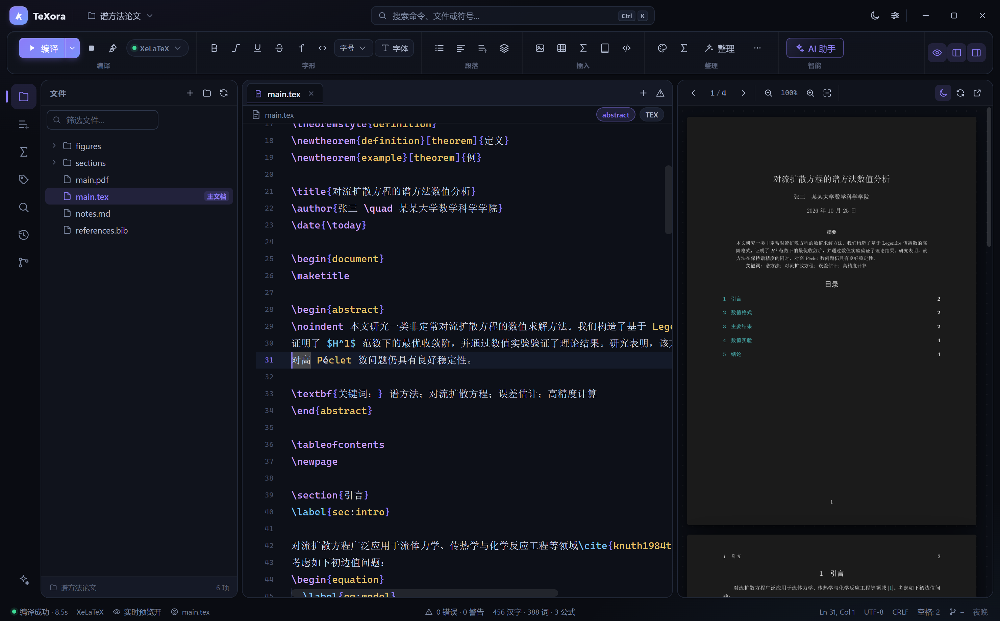

# TeXora 1.2.6 · 本地优先的 LaTeX 写作工作台

<p align="center">
  
</p>

源码与下载：[GitHub · Derek-Y-JQ/TeXora](https://github.com/Derek-Y-JQ/TeXora)

TeXora 是一款面向 Windows 的现代本地 LaTeX 编辑器：**Electron + Monaco + 本地 TeX 工具链**。
它把「源码编辑 / 实时 PDF 预览 / 双向 SyncTeX / Notion 式 Block 交互 / AI 受控改写 / 本地历史与 Git」
放进同一个安静的工作台，并提供 **Daylight（白天）** 与 **Midnight（夜晚）** 两套完整主题。

> 所有文档处理都在本机完成；只有在启用 AI 功能时，所选上下文才会发送到你配置的模型服务商。



---

## 更新记录

### 1.2.6
- 公式预览取消 64 个上限，改为按需渲染全部公式；长 TikZ 代码不再因长度被跳过，超时提高到 120 秒。
- 预览改为 3 个并发任务 + 导言区缓存，长文档公式加载明显加快。
- 标签与引用列表支持长标签自动换行，不再挤压环境名与行号。
- 局部预览导言区增强：展开项目 \input、读取本地 .sty/.cls 中的宏/颜色/tikzset，支持 TEXINPUTS 与 graphicspath，保留 setlength、newcommand、newcolumntype 等设置，解决预览缺少导言区配置的问题。

### 1.2.5 · 首个 GitHub 发布版本
- 打开项目优先加载已有 PDF，不触发重新编译。
- 修复 proofs.tex 后续公式（预览上限 64）与 align/gather 环境局部编译。
- 查找替换支持区分大小写、替换当前、全部替换。
- 选中文字右键菜单：剪切/复制/粘贴/AI/查找；移除悬浮 AI 按钮。
- 四套浅色主题重调正文为深灰/黑/深蓝；英文正文不再被当成代码着色。
- 按项目自动选择 XeLaTeX / pdfLaTeX / LuaLaTeX。
- 内置「去AI味」Skill，润色自动注入。
- 启动时自动检查 GitHub Releases 更新（每天最多一次），可在设置中关闭。

> 1.2.5 是 GitHub 上的第一个版本，此前版本的更新记录不再列出。

### 1. 工作区与界面
- **三栏布局**：文件/大纲/数学环境/标签引用/搜索/历史/Git/AI 侧边栏 + 编辑区 + PDF 预览区，分栏比例可拖拽、双击复位、一键折叠。
- **顶部功能区**：编译控制（引擎切换、停止、清理）、字形（加粗/斜体/下划线/删除线/强调/等宽）、字号、本地字体、列表与对齐、图片/表格/数学符号/文献、格式整理、AI 助手。
- **底部状态栏**：编译状态、引擎、实时预览开关、主文档、问题计数、字数/汉字/公式统计、光标行列、编码、缩进、Git 分支、主题。
- **命令面板**：`Ctrl+K`，支持 `>` 仅命令、`@` 文件、`:` 标签跳转。
- **问题面板**：解析 `.log` 与编译输出，区分 Error / Warning / BadBox，点击跳转源码行；另有完整编译日志视图。

### 2. 智能编辑（Monaco）
- **LaTeX 语法高亮**：自定义 Monarch 语法（命令、环境名、数学模式、注释、可选参数），MathJax 式数学模式着色。
- **环境联动补全**：输入 `\begin{` 弹出按常用度排序的环境候选；接受后自动补全 `\end{...}` 并缩进光标（可在设置中关闭）。
- **环境拼写诊断**：未闭合环境、未知环境名在 `\begin` 处给出警告/提示与悬浮说明。
- **上下文补全**：`\usepackage{}`（读取本地已安装宏包 + 常用清单）、`\input/\include`（项目 .tex）、`\includegraphics`（图片资源）、`\ref/\eqref`（文档标签）、`\cite`（BibTeX 键）、`enumitem` 选项、数学命令、代码片段（输入 `mk`、`ali`、`thm`… 后 Tab 展开）。
- **列表增强**：`itemize/enumerate/description` 内回车自动续写 `\item`，空项回车退出列表。
- **块（Block）模式**：独立段落与最外层环境识别为视觉块，悬浮显示拖拽手柄与 AI 快捷条，支持上下拖动重排；所有环境与章节支持折叠。
- **本地字体**：读取 Windows 字体注册表，按中文/英文/等宽分类预览，选中后自动写入 `fontspec` / `xeCJK` 导言区配置。

### 3. 即时预览
- **行间公式内联预览**：`equation/align/\[...\]` 环境由本地 XeLaTeX 独立编译并光栅化后，以视图区域嵌在源码中。
- **悬浮预览**：`$...$` 公式、`\includegraphics` 缩略图（含文件大小）、`\ref` 目标上下文、`\cite` 文献信息、`\begin{env}` 环境说明。
- **TikZ / 表格预览**：`tikzpicture`、`tabular/tblr/longtable` 自动局部编译预览，无需等待全文编译。
- **Markdown**：`.md` 文件在预览栏实时渲染，并可一键转换为 LaTeX 或另存 `.tex`。
- **PDF 预览**：pdftoppm 光栅化（128 DPI），支持缩放、适合宽度、翻页、暗色反色（保持图片可辨识）。
- **SyncTeX 双向定位**：双击源码行号 → PDF 位置高亮闪烁；双击 PDF 内容 → 源码行定位。

### 4. 编译与工程
- **多引擎**：XeLaTeX / pdfLaTeX / LuaLaTeX / latexmk，自动多遍编译与 BibTeX / Biber 文献链。
- **过程文件隔离**：所有 `.aux/.log/.synctex/.bbl/...` 输出到 `.latex_cache/`，主 PDF 同步到项目根目录。
- **缺失宏包**：识别 `File 'xxx.sty' not found`，可用 `mpm` / `tlmgr` 自动安装（支持清华、中科大、阿里云镜像），安装后自动重编。
- **主文档识别**：自动寻找含 `\documentclass` 的主文档，支持在子文件中编译；状态栏可手动切换。
- **实时预览**：停止输入 N 毫秒后自动增量编译（默认 900ms，可关闭）。
- **ChkTeX**：静态语法规范检查；**latexdiff**：选择两个文件生成红蓝增删对比 PDF。

### 5. AI 助手（受控非 Agent 模式）
- 支持 DeepSeek / OpenAI / Anthropic Claude / Google Gemini / Moonshot / 任意 OpenAI 兼容接口（Base URL + Key + 模型名）。
- **润色 / 提问 / 翻译 / 自定义指令**，作用于当前 Block 或选中源码；结果以 Diff 预览展示，只有点击「替换」或「插入到下方」才修改文件。
- 自动携带上下文：导言区自定义宏、项目文件列表、标签与文献键；可挂载本地 **Skills**（.md/.txt）作为写作规范。
- **编译错误诊断**：结合 `.log` 与源码上下文给出修复建议。
- **截图转 LaTeX**：剪贴板公式/表格截图交给多模态模型（`ai.ocrModel`）。
- 所有密钥仅保存在本机设置文件中，不进入渲染进程。

### 6. 文件与版本
- **本地历史**：保存与编译成功时快照，时间轴浏览、Diff 对比、一键恢复（存储于用户数据目录，不污染项目）。
- **Git 面板**：分支、更改、暂存、提交、Pull/Push、最近提交；未安装 Git 时给出明确提示。
- **模板中心**：中文论文/课程报告、English Paper、IEEE、Beamer、CV、数学试卷、书籍/学位论文、投稿信、空白文档。
- **新建文档向导**：文档类、纸张、字号、分栏、常用宏包勾选，实时预览导言区。
- **表格向导**：三线表 / 普通表格 / longtable / Tabularray，可视化网格 + Excel/CSV 粘贴解析。
- **文献管理**：`.bib` 表单化卡片编辑、引用选择器、DOI / arXiv 抓取 BibTeX、未引用/缺失检测。
- **文件关联**：安装程序注册 `.tex/.ltx/.sty/.cls/.bib/.md`。

### 7. 设置（6 大分类）
`编辑器与交互` · `编译与预览` · `宏包与 TeX 环境` · `AI 助手` · `外观与主题` · `快捷键` · `文件与备份`
（详见 [用户指南](docs/USER-GUIDE.md)）

---

## 环境要求

| 组件 | 说明 |
| --- | --- |
| Windows | 10 / 11（x64） |
| TeX 发行版 | MiKTeX 或 TeX Live / TinyTeX，需要 `xelatex`（中文文档请使用 ctex 类） |
| PDF 光栅化 | `pdftoppm` 或 `pdftocairo`（MiKTeX / TeX Live 自带 poppler） |
| SyncTeX | `synctex`（发行版自带） |
| 可选 | `chktex`（语法检查）、`latexdiff`（对比导出）、Git for Windows（版本面板） |

TeXora 会自动探测 PATH 以及常见安装目录（MiKTeX、TeX Live、TinyTeX），也可在设置中手工指定可执行文件目录。

---

## 安装与运行

### 使用安装包（推荐）
1. 运行 `TeXora-Setup-1.2.6.exe`（安装前请先退出正在运行的 TeXora）；安装包固定为「为所有用户安装」，会请求管理员权限（UAC），选择安装目录；安装开始时会自动检测并静默卸载旧的「仅本用户」版本（保留用户数据）；
2. 首次启动会自动探测 TeX 发行版；
3. 打开一个 LaTeX 项目文件夹（或「模板中心 → 创建项目」），点击「编译」。

### 开发模式
```powershell
cd texora
npm install            # 安装 electron / vite / monaco-editor
npm run build          # 构建渲染进程
npm start              # 构建并启动 Electron
npm run dist           # 生成 NSIS 安装包（release/）
```

### 自动化验证
项目内置基于 CDP（Chrome DevTools Protocol）的截图与交互验证脚本：

```powershell
# 启动并用脚本截图 / 检查（会写入 .capture/）
node scripts/cdp.mjs --script scripts/verify-ui.mjs -- --project=samples/demo
node scripts/cdp.mjs --script scripts/verify-interactions.mjs -- --project=samples/demo
node scripts/cdp.mjs --eval "document.title" -- --project=samples/demo
```

> 开发提示：Chromium 在本机某些受保护目录（如 DSH 工作区）中启动会因沙箱失败，
> 可用 `scripts/shot.mjs` 从 `C:\Temp` 下的短路径 Electron 启动应用；
> 打包/安装到 `%LOCALAPPDATA%\Programs\TeXora` 不受此限制。

---

## 快捷键

| 操作 | 快捷键 |
| --- | --- |
| 编译 / 停止 | `Ctrl+Alt+B`（预设可改）/ 点击状态栏 |
| 保存 / 全部保存 | `Ctrl+S` / `Ctrl+Shift+S` |
| 加粗 / 斜体 / 下划线 / 强调 | `Ctrl+B` / `Ctrl+I` / `Ctrl+U` / `Ctrl+E` |
| 命令面板 | `Ctrl+K` 或 `Ctrl+Shift+P` |
| 当前文件查找 / 替换 | `Ctrl+F` / `Ctrl+H` |
| 跳转到行 | `Ctrl+G` |
| 切换主题 | `Ctrl+Shift+L` |
| 问题面板 | `Ctrl+Shift+M` |
| 插入文献引用 | `Ctrl+Shift+C` |
| AI 助手 | `Ctrl+Shift+A` |
| 折叠侧边栏 / 预览 | `Ctrl+Alt+1` / `Ctrl+Alt+2` |
| 正向定位 | 双击源码行号 |
| 反向定位 | 双击 PDF 内容 |
| 专注模式 | `F11` |

设置 → 快捷键支持 VS Code / WinEdt / Texifier / Vim 预设，并可为任意命令录制自定义组合键。

---

## 项目结构

```
texora/
├─ electron/
│  ├─ main.js              # 主进程：窗口、app:// 与 asset:// 协议、IPC 注册、截图模式
│  ├─ preload.js           # contextBridge：window.texora 白名单 API
│  └─ lib/
│     ├─ store.js          # 设置持久化（深合并 + 点路径读写）
│     ├─ fsops.js          # 项目树、读写、重命名/移动、资源扫描、主文档识别
│     ├─ run.js            # 子进程执行（输出落盘 + 轮询，避免 Windows 管道限制）
│     ├─ texenv.js         # TeX 发行版/引擎/宏包/字体/synctex/pdftoppm 探测
│     ├─ compiler.js       # 编译链、日志解析、PDF 光栅化、SyncTeX、片段编译、ChkTeX、latexdiff
│     ├─ history.js        # 本地快照
│     ├─ search.js         # 项目级搜索（大小写/整词/正则/glob）
│     ├─ ai.js             # 多服务商请求代理、Skills、错误映射
│     └─ git.js            # Git 集成（可选）
├─ src/
│  ├─ index.html           # 应用骨架 + SVG 图标精灵
│  ├─ main.js              # 渲染进程入口：启动、布局、文档、编译、面板、状态栏
│  ├─ styles/              # 设计令牌/组件/布局/弹窗
│  └─ js/
│     ├─ editor.js         # Monaco、语法、补全、悬浮卡片、Block、折叠、公式视图区
│     ├─ preview.js        # PDF 预览、缩放、反色、SyncTeX 反向
│     ├─ sidebar.js        # 8 个侧边栏面板
│     ├─ ribbon.js         # 顶部工具栏与菜单
│     ├─ commands.js       # 命令注册、快捷键、命令面板
│     ├─ settings-ui.js    # 设置面板
│     ├─ dialogs.js        # 模态框、模板/表格/图片/字号/字体/文献等
│     ├─ ai.js             # AI 动作与 Diff 预览
│     └─ latex.js 等       # 解析、格式化、片段、BibTeX、Markdown、符号库
├─ samples/demo/           # 演示项目（中文论文 + 图 + TikZ + 表格 + Markdown 笔记）
├─ scripts/                # CDP 截图/交互验证脚本
└─ docs/                   # 用户指南与截图
```

---

## 已知限制

- **PDF 预览为光栅图**：不支持在 PDF 中选中文字/搜索；反向定位依赖 SyncTeX 坐标映射。后续可接入 pdf.js 文本层。
- **AI 需要自备 API Key**：不使用离线模型；未配置时界面会引导到设置。AI 不修改文件，必须先确认 Diff。
- **未内置拼写词典**：拼写检查由 ChkTeX 静态规范检查替代；如需 Hunspell 词典需额外配置。
- **Markdown 转换是基础实现**：标题/列表/强调/代码/链接/表格，复杂语法建议手工微调。
- **宏包安装需要管理器**：MiKTeX 使用 `mpm`，TeX Live 使用 `tlmgr`（可能需要管理员权限）；TinyTeX 需自行配置。
- **Git 面板依赖系统 Git**；未安装时只提供本地历史与快照。
- **Web 字体/KaTeX 未内置**：公式预览完全由本地 LaTeX 渲染，保证与最终 PDF 一致，但首次渲染约 1–2 秒（命中缓存后即时）。

---

## 许可

MIT License，见 [LICENSE](LICENSE)。第三方组件与工具见 [THIRD_PARTY_NOTICES.md](THIRD_PARTY_NOTICES.md)。
